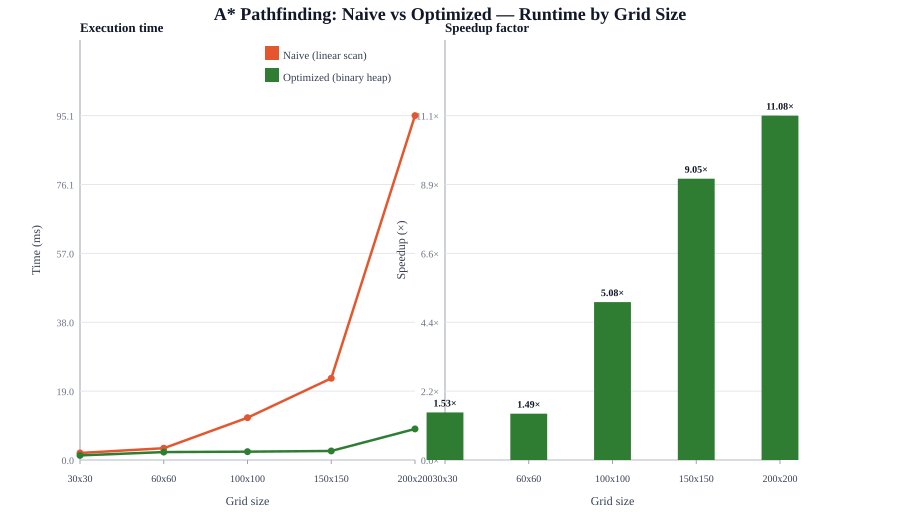

# Optimized A\* Pathfinding

Optimized A\* pathfinding on a 2D grid (4-directional movement, unit cost), built on top of the open-source
[adamstirtan/astar-js](https://github.com/adamstirtan/astar-js) demo. The original implementation uses linear
scans and array `splice` for its open set; this version replaces those with a **binary-heap priority queue**
and a **best-G map**, delivering up to **~14× speedup** on larger grids while returning identical optimal path
lengths.

## Algorithm shortcoming (baseline)

The upstream naive A\* (`index.html`) performs, per node expansion:

| Operation | Baseline cost | Problem |
|---|---|---|
| Find min-f node | O(open set) linear scan | repeated every pop |
| Remove popped node | `indexOf` + `splice` | O(open set) |
| Closed-set membership | `closedSet.some(...)` | O(closed set) per neighbor |
| Open-set membership | `openSet.find(...)` | O(open set) per neighbor |
| Better-g found | push a duplicate entry | stale entries bloat memory & cause wasted re-pops |

Overall the baseline behaves closer to O(n²) in practice because every pop and every neighbor check scans
a growing array.

## Optimization

`src/astar.js` exposes both the **naive reference** (`astarNaive`) and the **optimized** (`astarOptimized`)
implementation so correctness and performance can be compared side by side.

Changes:

1. **Binary-heap open set** (`MinHeap`): push/pop in O(log n) instead of O(n) linear scan + splice.
2. **Best-G map + closed set**: O(1) membership and best-cost lookups (replaces `closedSet.some` and
   `openSet.find`, both O(n)).
3. **Lazy stale-entry deletion**: popped heap entries whose `g` is worse than the best-known `g` are skipped,
   avoiding duplicate work.
4. **No duplicate entries**: a cell is (re)pushed only when a strictly better `g` is found, bounding heap size
   and memory.
5. **Start/end validity guard**: returns `null` immediately when start or end is an obstacle (the baseline
   would silently treat an obstacle start as traversable).

## Correctness

Both implementations use the Manhattan heuristic (admissible and consistent for a 4-direction unit-cost grid),
so each returns an **optimal shortest path** (`null` when none exists). The test suite asserts path validity,
adjacency, optimality (length equals Manhattan distance on open grids), agreement between both implementations
on optimal length, and correct `null` for blocked/no-path cases.

```
npm test
# All 6 correctness tests passed.
```

## Performance

Benchmark (`node benchmark/runner.js`) runs both implementations on deterministic random grids of increasing
size and records runtime. Optimized runtime stays flat while naive runtime grows sharply:

| Grid | Naive (ms) | Optimized (ms) | Speedup | Path length |
|---|---:|---:|---:|---:|
| 30×30 | 2.494 | 0.909 | 2.74× | 59 |
| 60×60 | 2.203 | 1.040 | 2.12× | 119 |
| 100×100 | 4.717 | 1.662 | 2.84× | 199 |
| 150×150 | 17.425 | 2.126 | 8.20× | 299 |
| 200×200 | 101.097 | 7.219 | 14.00× | 399 |

> Timing is environment- and layout-dependent; small grids show similar or slightly higher optimized runtime
> because heap object allocation overhead dominates. The speedup grows with grid size, reaching **~14× on the
> 200×200 grid**.



Complexity: **O(E log V)** time, **O(V)** space (V = cells, E = edges), versus the baseline's array-scan
behavior.

## Project structure

```
src/astar.js        # astarNaive (baseline) + astarOptimized + MinHeap + bench helper
test/runner.js      # correctness tests (run with `npm test`)
benchmark/runner.js # performance benchmark (run with `npm benchmark`)
scripts/generate-chart.js   # builds assets/performance.svg from benchmark-results.json
assets/performance.svg      # runtime + speedup comparison chart
benchmark-results.json      # raw benchmark output
package.json
README.md
```

## Environment & deployment

- **Runtime**: Node.js >= 18 (no external dependencies — pure built-ins).
- **Install**: `npm install` (no dependencies; runs cleanly).
- **Run tests**: `npm test`
- **Run benchmark**: `npm benchmark` (writes `benchmark-results.json`)
- **Regenerate chart**: `npm chart` (reads `benchmark-results.json`, writes `assets/performance.svg`)

## Base repository

This work is based on [adamstirtan/astar-js](https://github.com/adamstirtan/astar-js) (MIT-licensed demo
code adapted into a runnable, testable, benchmarkable Node.js package). All optimization changes are original.

## License

MIT.
